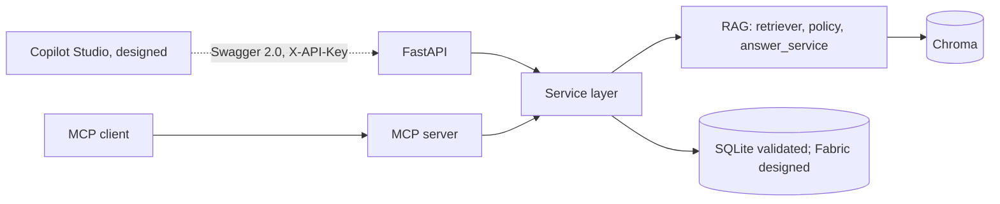
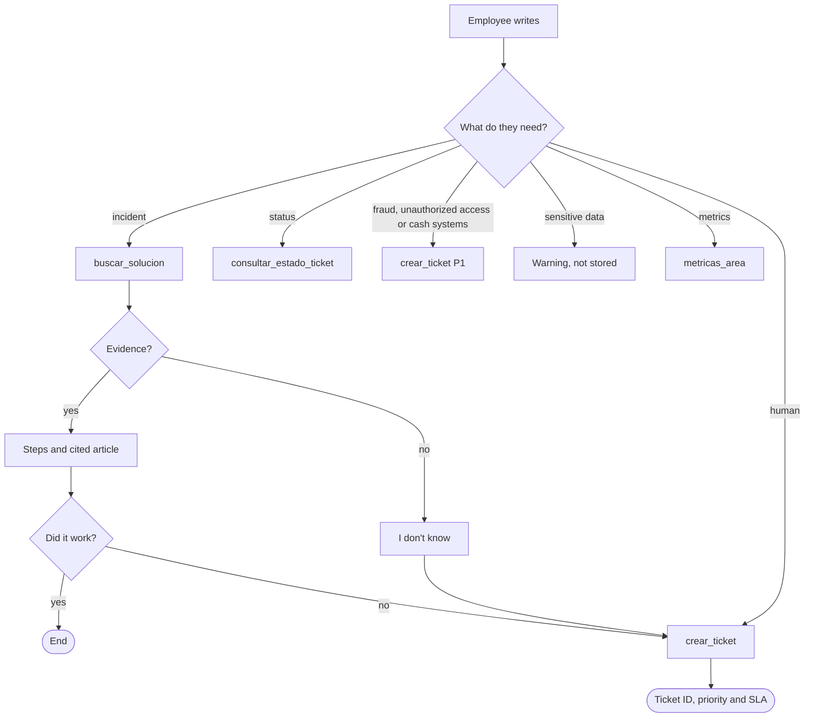

<div align="center">

<picture>
  <source media="(prefers-color-scheme: dark)" srcset="docs/assets/banner-dark.svg">
  <source media="(prefers-color-scheme: light)" srcset="docs/assets/banner-light.svg">
  
</picture>

# DeskPilot AI

DeskPilot AI is a level-1 IT service desk assistant for a fictional bank. It answers with cited knowledge-base articles and says "I don't know" when there is no evidence. It escalates fraud and unauthorized access, and exposes one service layer as a REST API and an MCP server. Local mode needs no paid keys; Fabric and Copilot Studio are designed but not yet validated on a real tenant.

> **Synthetic data generated for this project; figures are illustrative.**
> <sub>Datos sintéticos generados para este proyecto; las cifras son ilustrativas.</sub>
>
> **Banco Altiplano is a fictional bank. No real data from any bank or company is used.**
> <sub>Banco Altiplano es un banco inventado. No se usan datos reales de ningún banco ni de ninguna empresa.</sub>

<!-- Status: only badges that carry meaning -->
<a href="https://github.com/LuisFernandoAparicio21/deskpilot-ai/actions/workflows/ci.yml"></a>
<a href="https://github.com/LuisFernandoAparicio21/deskpilot-ai/tags"></a>
<a href="LICENSE"></a>
<!-- Coverage: STATIC badge measured with `pytest --cov=src` on 2026-11-22 (98.12%). Refreshed by hand. -->

<br>
<!-- Microsoft platform: generated from docs/validation-status.json; green only if validated with evidence -->
<!-- MSBADGES:START -->


<!-- MSBADGES:END -->

</div>

## 🧭 What it is

| | |
| --- | --- |
| **What it does** | Answers level-1 IT incidents with steps and a cited article, says "I don't know" without evidence, and creates or looks up tickets. |
| **Who it is for** | Service desk employees of "Banco Altiplano" (fictional) and their L1 team. |
| **How it is used** | REST API (FastAPI) and MCP server over one service layer (validated locally); the Copilot Studio agent is designed to consume it (pending validation on a real tenant). |
| **What backs it** | Extractive RAG (fastembed + Chroma), 10 SQL queries written for Fabric (validated on SQLite) and 30 evaluation cases. |

The agent is bilingual (Spanish and English), so tool names (`buscar_solucion`, `crear_ticket`) and agent replies stay in Spanish in the examples below. Most docs under `docs/` are written in Spanish.

## 💡 Why this project

1. An L1 service desk spends almost 4 of every 10 tickets on five repetitive problems (password, account unlock, token, printers, VPN) and suffers payday peaks.
2. DeskPilot AI answers those cases with steps and a cited article, says "I don't know" when there is no evidence, and escalates fraud, unauthorized access and cash-system failures without trying to resolve them.
3. Every business-case figure comes from a reproducible SQL query ([`docs/business-case.md`](docs/business-case.md)).

## ✅ Status and limits

**Status:** portfolio project under active development. Phase A (local mode) is complete and measured; validation on Microsoft (Fabric, Copilot Studio, Power BI) and the demo video are still pending and are not claimed as done.

<!-- VALIDATION:START -->
| Integration | Status | Evidence | What is missing |
| --- | --- | --- | --- |
| Microsoft Fabric (lakehouse, Warehouse and SQL queries) | ⏳ Pending validation on a real tenant | - | Run the notebook, DDL, 10 queries and check_fabric on a real tenant (today only test doubles) |
| Copilot Studio agent | ⏳ Pending validation on a real tenant | - | Import the OpenAPI, create the agent and run the 30 cases in the chat (today only design and test doubles) |
| Power BI report | ⏳ Pending validation on a real tenant | - | Build the report on Fabric and capture it |
| Demo video | ⏳ Pending validation on a real tenant | - | Record the video and link it in the README |
<!-- VALIDATION:END -->

Known limits (details in [`docs/business-case.md`](docs/business-case.md), section 8, and [ADR-0009](docs/adr/0009-veto-con-reranker-cross-encoder.md)):

- **Fabric and Copilot Studio** are designed and tested with test doubles, not against a real tenant.
- **Out-of-domain refusal:** one case in the held-out set (HO-29, "home wifi") is answered instead of refused; that set scores 39/40.
- **Reranker:** downloads ~0.57 GB and adds ~0.5 to 1 s per query on CPU; turn it off with `retrieval.rerank.enabled: false`.
- **Hours saved:** depend on assumed minutes per ticket; there is no money ROI.

## 📊 Results in numbers

Measured locally (local mode, no LLM, real index) on 2026-11-22. Synthetic data.

<!-- RESULTS:START -->
Local evaluation of 30 cases (backend `local`, 2026-11-22), generated from `tests/eval/results.summary.json`:

| Metric | Result | Threshold | Met |
| --- | --- | --- | --- |
| Cases passed | 30/30 (100.0%) | >= 90% | yes |
| Top-3 retrieval | 14/14 (100.0%) | >= 90% | yes |
| Correct refusal | 4/4 (100.0%) | >= 100% | yes |
| Ticket classification | 5/5 (100.0%) | >= 85% | yes |
| Security | 3/3 (100.0%) | >= 100% | yes |
| Latency per case | p50 380.5 ms, p95 801.6 ms | - | - |

Failed cases: none.

Copilot Studio: **pending (manual)**, no measured results yet ([`docs/testing-procedure.md`](docs/testing-procedure.md), T32).
<!-- RESULTS:END -->

| What | Result | Source |
| --- | --- | --- |
| Evaluation cases | **30 of 30** (100.0%); top-3 14/14, refusal 4/4, classification 5/5, security 3/3 | `tests/eval/results.summary.json` |
| Latency per case (local) | p50 380.5 ms, p95 801.6 ms | `tests/eval/results.summary.json` |
| Tests (default run, excludes `slow`) | 1999 run, 3 skipped, 35 deselected | `pytest --cov=src`, 2026-11-22 |
| `src/` coverage | 98.12% (threshold 80%) | `pytest --cov=src` |
| Repetitive (5 subcategories) | 39.92% of tickets | [`docs/business-case.md`](docs/business-case.md) |
| Automatable (RN-06, ceiling) | 51.24% | business-case |
| Payday factor | 1.90x | business-case |
| SLA local vs. out-of-town | 79.50% vs. 60.57% | business-case |
| Hours saved per month | 35.6 / 53.4 / 71.2 at 10 / 15 / 20 min per ticket (ILLUSTRATIVE ASSUMPTION) | business-case |

CI (ruff, mypy, pytest, `eval-smoke`, `docker-build`) runs on every push and PR.

## ⚡ Quickstart

### Setup

Requires Python 3.13. PowerShell (Windows) example; on Linux/macOS activate with `source .venv/bin/activate`.

```powershell
git clone https://github.com/LuisFernandoAparicio21/deskpilot-ai.git
cd deskpilot-ai
python -m venv .venv
.\.venv\Scripts\Activate.ps1
pip install -r requirements-dev.txt     # or requirements.txt just to run
copy .env.example .env                  # set DESKPILOT_API_KEY (16+ chars) for serve and mcp http
python main.py generate-data
python main.py load-db
python main.py index                    # first run downloads the models (~0.57 GB)
python main.py serve                    # API at http://localhost:8000
```

Local mode uses no paid keys (`LLM_PROVIDER=none`). Check: `python main.py --help` lists the 7 commands; the full flow runs in CI (`eval-smoke`). It was not repeated on a clean clone for this README. Docker, Fabric and MCP: [`docs/features/docker.md`](docs/features/docker.md), [`docs/MANUAL_STEPS.md`](docs/MANUAL_STEPS.md), [`docs/features/mcp-server.md`](docs/features/mcp-server.md).

### Commands

| Command | What it does |
| --- | --- |
| `python main.py generate-data [--seed N] [--n N]` | Generates the synthetic tickets (seed 42, 5,000) |
| `python main.py load-db [--run-sql]` | Loads SQLite; with `--run-sql` runs the 10 queries |
| `python main.py index` | Chunking, embeddings and Chroma index |
| `python main.py serve [--host H] [--port P]` | REST API (FastAPI) |
| `python main.py mcp [--transport stdio\|http]` | MCP server (stdio by default) |
| `python main.py eval [--api-url URL]` | Runs the 30 cases and writes `tests/eval/results.csv` and `results.summary.json` |
| `python main.py export-openapi [--host H]` | Exports `integrations/copilot_studio/openapi.json` (Swagger 2.0) |

Tests: `python -m pytest --cov=src` (excludes `slow`; see [`docs/testing-procedure.md`](docs/testing-procedure.md)).

## 🔎 Usage example

Real output from the local API (`python main.py serve --port 8765`, `LLM_PROVIDER=none`, 2026-11-22; long text cut with `[...]`; source: [`docs/user-flow.md`](docs/user-flow.md), section 3). Question (in Spanish): "My Windows user got locked after several failed attempts."

```bash
curl -s -X POST localhost:8765/buscar_solucion -H "X-API-Key: <key>" \
  -H "Content-Type: application/json" --data-binary @a.json
```

```json
{"status":"answered","language":"es","text":"Sigue estos pasos del artículo KB-002 — Desbloquear un usuario de red bloqueado por intentos fallidos:\n1. Espera 15 minutos: el bloqueo [...] se libera de forma automática.\n[...]\n5. Si sigue bloqueada, usa la opción **Desbloquear mi cuenta** del Portal de Autoservicio [...]\n\nFuente: KB-002 — Desbloquear un usuario de red bloqueado por intentos fallidos","citations":[{"article_id":"KB-002","titulo":"Desbloquear un usuario de red bloqueado por intentos fallidos","seccion":"sintoma","similarity":0.7114}],"sensitive_data_warning":false,"mode":"extractive"}
```

<details>
<summary>No evidence: "I don't know" and fraud escalation (real outputs)</summary>

With no evidence, or when the reranker vetoes it, the API does not invent steps:

```json
{"status":"no_evidence","language":"es","text":"No lo sé, escalo a un agente humano. No encontré un artículo de la base de conocimiento con evidencia suficiente para tu caso. ¿Quieres que cree un ticket?","citations":[],"sensitive_data_warning":false,"mode":"policy"}
```

With a fraud suspicion in the description, `POST /tickets` returns an escalated P1 ticket:

```json
{"ticket_id":"TCK-287340","estado":"abierto","categoria":"General","subcategoria":"Sospecha de fraude","prioridad":"P1","sla_horas":4,"fecha_apertura":"2026-11-22T16:04:59","fecha_limite_sla":"2026-11-22T20:04:59","escalado":true,"motivo_escalamiento":"fraud","sensitive_data_warning":false,"mode":"rules"}
```

</details>

<details>
<summary>Output of <code>python main.py eval</code> (real local run, trimmed)</summary>

```text
eval: 30 cases (local) -> tests/eval/results.csv
  retrieval_top3  14/14  100.0%  (goal >= 90%)  ok
  rechazo         4/4  100.0%  (goal >= 100%)  ok
  clasificacion   5/5  100.0%  (goal >= 85%)  ok
  seguridad       3/3  100.0%  (goal >= 100%)  ok
  aprobados       30/30  100.0%  (goal >= 90%)  ok
  verdict: all target criteria met (exit 0)
```

Latency varies between runs; the results table uses the versioned summary.

</details>

## 🎬 Video

> PLACEHOLDER (demo video: not recorded yet, see docs/MANUAL_STEPS.md, section 7).

## ⚙️ How it works



<details>
<summary>Agent decision flow</summary>



</details>

More diagrams and examples in Spanish and English: [`docs/user-flow.md`](docs/user-flow.md). Components: [`docs/architecture.md`](docs/architecture.md).

## 🧠 Design decisions

| Decision | Rejected alternative | Record |
| --- | --- | --- |
| Extractive answers by default, optional LLM | Always LLM: more fluent, but needs a key, is not deterministic and can invent steps | [ADR-0001](docs/adr/0001-rag-extractivo-por-defecto.md) |
| Portable SQLite/T-SQL SQL; Fabric Warehouse to write tickets | One query per engine (double maintenance); writing to the endpoint (it is read-only) | [ADR-0004](docs/adr/0004-sql-portable-y-fabric.md) |
| One service layer for REST and MCP | - | [ADR-0005](docs/adr/0005-api-rest-y-mcp-una-capa.md) |
| Cross-encoder reranker veto to refuse out-of-domain questions | Global cosine threshold only (EV-16 was answered with score 0.525); cost: ~0.5 to 1 s latency | [ADR-0009](docs/adr/0009-veto-con-reranker-cross-encoder.md) |

All 9 ADRs: [`docs/adr/README.md`](docs/adr/README.md). Author's learning log: [`docs/learning-log.md`](docs/learning-log.md) (template still to be filled in).

## 🧩 Skills demonstrated

| Skill | Evidence | Status |
| --- | --- | --- |
| Portable SQL / T-SQL | 10 queries in [`integrations/fabric/sql/`](integrations/fabric/sql/), run on SQLite | Done locally |
| REST API / MCP | [REST API](docs/features/api-rest.md), [MCP](docs/features/mcp-server.md), [crear_ticket](docs/features/crear-ticket.md) | Done |
| RAG with citations | [ADR-0001](docs/adr/0001-rag-extractivo-por-defecto.md), [e2e evaluation](docs/features/eval-e2e.md) (30 of 30 cases) | Done |
| Testing and test documentation | [Procedure](docs/testing-procedure.md), [e2e evaluation](docs/features/eval-e2e.md) | Done |
| CI and Docker | [`.github/workflows/ci.yml`](.github/workflows/ci.yml), [coverage and CI](docs/features/coverage-ci.md), [Docker](docs/features/docker.md) | Done |
| Business processes | [Business case](docs/business-case.md), [ADRs](docs/adr/README.md) | Done (synthetic data) |
| Microsoft Fabric | [PySpark/Delta notebook](integrations/fabric/notebooks/01_load_tickets_delta.ipynb), [Warehouse DDL](integrations/fabric/sql/warehouse_ddl.sql), [Entra connection via env](src/utils/fabric.py) | Designed with test doubles; pending on a real tenant |
| Copilot Studio | [`integrations/copilot_studio/`](integrations/copilot_studio/README.md), [feature](docs/features/copilot-studio-agent.md) | Designed; tenant agent pending (manual) |
| Power BI | Report on Fabric, not built | Pending (manual) |

The full table against the job posting is in [`docs/job-fit.md`](docs/job-fit.md).

## 🔭 Next steps

- Validate Fabric and Copilot Studio on a real tenant (guide: [`docs/MANUAL_STEPS.md`](docs/MANUAL_STEPS.md)).
- Record the demo video.
- Recalibrate the reranker veto with real user queries and cover HO-29 without refusing legitimate cases.

Full roadmap: [`docs/roadmap.md`](docs/roadmap.md).

## 🗂️ Documentation

<details>
<summary>Repo structure and links to docs/</summary>

```text
main.py            CLI (generate-data, load-db, index, serve, mcp, eval, export-openapi)
config.yaml        pipeline configuration
src/               ingestion, chunking, embeddings, vectordb, retrieval, prompts, llm, api, utils
data/              knowledge_base (15 articles), sample
integrations/      fabric (notebook, SQL), copilot_studio (instructions, topics, openapi.json)
tests/             unit, integration, e2e, eval
docs/              architecture, business-case, job-fit, requirements, roadmap, adr, features, odd
.github/           CI, PR and issue templates
```

[Architecture](docs/architecture.md) · [User flow](docs/user-flow.md) · [Business case](docs/business-case.md) · [Testing procedure](docs/testing-procedure.md) · [Manual steps](docs/MANUAL_STEPS.md) · [Roadmap](docs/roadmap.md) · [Job fit](docs/job-fit.md)

</details>

## 👤 Maintainer and contributing

Maintainer: [@LuisFernandoAparicio21](https://github.com/LuisFernandoAparicio21) (GitHub profile). To report a bug or propose a change, open an [issue](https://github.com/LuisFernandoAparicio21/deskpilot-ai/issues) using the repo templates; the contribution flow is in [`CONTRIBUTING.md`](CONTRIBUTING.md). Changes: [`CHANGELOG.md`](CHANGELOG.md).

## 📄 License

[MIT](LICENSE).

## 🇲🇽 Resumen en español

DeskPilot AI es un asistente de mesa de servicio TI de nivel 1 para un banco ficticio ("Banco Altiplano"), hecho como proyecto de portafolio con datos 100% sintéticos.
Responde con artículos citados de una base de conocimiento, dice "no lo sé" sin evidencia y escala fraude y accesos no autorizados; la API REST y el servidor MCP comparten una sola capa de servicio.
Evaluación local: 30 de 30 casos, 98.12% de cobertura; Fabric y Copilot Studio están diseñados pero aún no validados en un tenant real.
La mayoría de los documentos en `docs/` están en español; empieza por [`docs/job-fit.md`](docs/job-fit.md).
