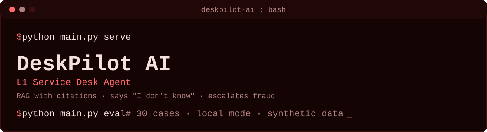
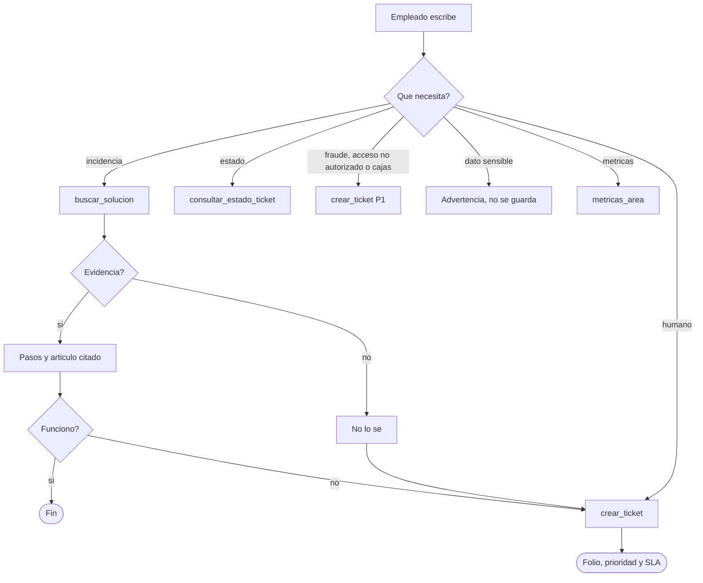
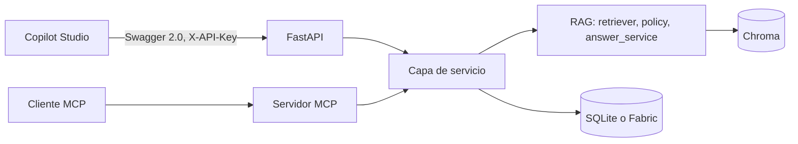

<div align="center">

<picture>
  <source media="(prefers-color-scheme: dark)" srcset="docs/assets/banner-dark.svg">
  <source media="(prefers-color-scheme: light)" srcset="docs/assets/banner-light.svg">
  
</picture>

<p align="center">
  <a href="https://github.com/DenverCoder1/readme-typing-svg"></a>
</p>

**English:** DeskPilot AI is a level-1 IT service desk assistant for a fictional bank. It answers with cited knowledge-base articles and says "I don't know" when there is no evidence.
It escalates fraud and unauthorized access, and exposes one service layer as a REST API and an MCP server.
Local mode needs no paid keys; Fabric and Copilot Studio are designed but not yet validated on a real tenant.

> **Datos sintéticos generados para este proyecto; las cifras son ilustrativas.**
>
> **Banco Altiplano** es un banco inventado. No se usan datos reales de ningún banco ni de ninguna empresa.

<!-- Estado -->
<a href="https://github.com/LuisFernandoAparicio21/deskpilot-ai/actions/workflows/ci.yml"></a>
<a href="https://github.com/LuisFernandoAparicio21/deskpilot-ai/tags"></a>
<a href="LICENSE"></a>
<!-- Cobertura: badge ESTATICO medido con `pytest --cov=src` el 2026-11-22 (98.24%). No es un servicio de cobertura: se refresca a mano (update_readme_results solo mantiene el bloque RESULTS). -->

<br>
<!-- Stack -->


<br>
<!-- Plataforma Microsoft: solo probada con dobles; nunca verde -->


</div>

---

## 🧭 Qué es

| | |
| --- | --- |
| **Qué hace** | Responde incidencias de TI de nivel 1 con pasos y artículo citado, dice "no lo sé" sin evidencia y crea o consulta tickets. |
| **Para quién** | Empleados de la mesa de servicio de "Banco Altiplano" (ficticio) y su equipo L1. |
| **Cómo se usa** | API REST (FastAPI), servidor MCP y agente de Copilot Studio (diseño) sobre una misma capa de servicio. |
| **Qué lo respalda** | RAG extractivo (fastembed + Chroma), 10 consultas SQL portables a Fabric y 30 casos de evaluación. |

---

## 💡 Por qué este proyecto

1. Una mesa de servicio L1 gasta casi 4 de cada 10 tickets en cinco problemas repetitivos (contraseña, desbloqueo, token, impresoras, VPN) y sufre picos de quincena.
2. DeskPilot AI responde esos casos con pasos y artículo citado, dice "no lo sé" cuando no hay evidencia y escala fraude, accesos no autorizados y fallas de caja sin intentar resolverlos.
3. Cada cifra del caso de negocio sale de una consulta SQL reproducible ([`docs/business-case.md`](docs/business-case.md)).

---

## ⚙️ Cómo funciona



Diagramas completos y ejemplos reales en español e inglés: [`docs/user-flow.md`](docs/user-flow.md). Componentes: [`docs/architecture.md`](docs/architecture.md).

---

## 📊 Resultados en números

Medidos en local (modo local, sin LLM, índice real) el 2026-11-22. Datos sintéticos.

<!-- RESULTS:START -->
Evaluación local de 30 casos (backend `local`, 2026-11-22), generada desde `tests/eval/results.summary.json`:

| Métrica | Resultado | Umbral | Cumple |
| --- | --- | --- | --- |
| Casos aprobados | 29/30 (96.7%) | >= 90% | sí |
| Recuperación top-3 | 14/14 (100.0%) | >= 90% | sí |
| Rechazo correcto | 3/4 (75.0%) | >= 100% | no |
| Clasificación de tickets | 5/5 (100.0%) | >= 85% | sí |
| Seguridad | 3/3 (100.0%) | >= 100% | sí |
| Latencia por caso | p50 13.8 ms, p95 31.5 ms | - | - |

Casos fallidos: EV-16.

Copilot Studio: **pendiente (manual)**, sin resultados medidos todavía ([`docs/testing-procedure.md`](docs/testing-procedure.md), T32).
<!-- RESULTS:END -->

| Qué | Resultado | Fuente |
| --- | --- | --- |
| Casos de evaluación | **29 de 30** (96.7%); top-3 14/14, rechazo 3/4, clasificación 5/5, seguridad 3/3 | `tests/eval/results.summary.json` |
| Latencia por caso (local) | p50 13.8 ms, p95 31.5 ms | `tests/eval/results.summary.json` |
| Pytest | 1770 passed, 3 skipped, 33 deselected (`slow`) | `pytest --cov=src`, 2026-11-22 |
| Cobertura de `src/` | 98.24% (umbral 80%) | `pytest --cov=src` |
| Repetitivo (5 subcategorías) | 39.92% de los tickets | [`docs/business-case.md`](docs/business-case.md) |
| Automatizable (RN-06, techo) | 51.24% | business-case |
| Factor de quincena | 1.90 veces | business-case |
| SLA local contra foráneo | 79.50% contra 60.57% | business-case |
| Horas ahorradas al mes | 35.6 / 53.4 / 71.2 con 10 / 15 / 20 min por ticket (SUPUESTO ILUSTRATIVO) | business-case |

El CI (ruff, mypy, pytest, `eval-smoke`, `docker-build`) corre en cada push y PR.

---

## 🎬 Demo

**Demo: próximamente** (fecha estimada: por definir, pendiente de grabar). Mientras tanto, esta es una ejecución local real de `python main.py eval` (salida recortada, 2026-11-22):

```text
eval: 30 cases (local) -> tests/eval/results.csv
  retrieval_top3  14/14  100.0%  (goal >= 90%)  ok
  rechazo         3/4   75.0%  (goal >= 100%)  BELOW
  clasificacion   5/5  100.0%  (goal >= 85%)  ok
  seguridad       3/3  100.0%  (goal >= 100%)  ok
  aprobados       29/30   96.7%  (goal >= 90%)  ok
  failed cases: EV-16
  verdict: thresholds NOT met
```

La latencia varía entre corridas (la de hoy: p50 14.7 ms, p95 31.0 ms); la tabla de arriba usa el resumen versionado.

## 🎬 Video

> PLACEHOLDER (video demo: pendiente de grabar, ver docs/MANUAL_STEPS.md, sección 7).

---

## ⚡ Quickstart en 5 min

### Setup

Requiere Python 3.13. Ejemplo en PowerShell (Windows); en Linux/macOS activa con `source .venv/bin/activate`.

```powershell
git clone https://github.com/LuisFernandoAparicio21/deskpilot-ai.git
cd deskpilot-ai
python -m venv .venv
.\.venv\Scripts\Activate.ps1
pip install -r requirements-dev.txt     # o requirements.txt solo para ejecutar
copy .env.example .env                  # define DESKPILOT_API_KEY (16+ caracteres) para serve y mcp http
python main.py generate-data
python main.py load-db
python main.py index                    # la primera vez descarga el modelo de embeddings (~250 MB)
```

El modo local no usa llaves de pago (`LLM_PROVIDER=none`). Los comandos se comprobaron con `python main.py --help`; el flujo completo corre en el CI (`eval-smoke`). No se repitió en un clon limpio para este README.

### Comandos

| Comando | Qué hace |
| --- | --- |
| `python main.py generate-data [--seed N] [--n N]` | Genera los tickets sintéticos (semilla 42, 5,000) |
| `python main.py load-db [--run-sql]` | Carga SQLite; con `--run-sql` ejecuta las 10 consultas |
| `python main.py index` | Chunking, embeddings e índice en Chroma |
| `python main.py serve [--host H] [--port P]` | API REST (FastAPI) |
| `python main.py mcp [--transport stdio\|http]` | Servidor MCP (stdio por defecto) |
| `python main.py eval [--api-url URL]` | Corre los 30 casos y escribe `tests/eval/results.csv` y `results.summary.json` |
| `python main.py export-openapi [--host H]` | Exporta `integrations/copilot_studio/openapi.json` (Swagger 2.0) |

**Docker** (modo local, usuario no root, modelo e índice en el build; ver [`docs/features/docker.md`](docs/features/docker.md)):

```powershell
docker build -t deskpilot-ai .
docker run -d --name deskpilot -p 8000:8000 -e DESKPILOT_API_KEY=<clave de 16+ caracteres> deskpilot-ai
curl.exe http://localhost:8000/health
```

### Estructura del repo

```text
main.py            CLI (generate-data, load-db, index, serve, mcp, eval, export-openapi)
config.yaml        configuración del pipeline
src/               ingestion, chunking, embeddings, vectordb, retrieval, prompts, llm, api, utils
data/              knowledge_base (15 artículos), sample
integrations/      fabric (notebook, SQL), copilot_studio (instrucciones, temas, openapi.json)
tests/             unit, integration, e2e, eval
docs/              architecture, business-case, job-fit, requirements, roadmap, adr, features, odd
.github/           CI, plantillas de PR e issues
```

## 🏗️ Arquitectura



Detalle y más diagramas en [`docs/architecture.md`](docs/architecture.md).

---

## 🧩 Habilidades demostradas

| Habilidad | Evidencia | Estado |
| --- | --- | --- |
| Copilot Studio | Diseño del agente: [`integrations/copilot_studio/`](integrations/copilot_studio/README.md), [feature](docs/features/copilot-studio-agent.md) | Diseño hecho; agente en el tenant pendiente (manual) |
| SQL | 10 consultas en [`integrations/fabric/sql/`](integrations/fabric/sql/), validadas en SQLite | Hecho en local; Fabric pendiente (manual) |
| Microsoft Fabric | [Notebook PySpark/Delta](integrations/fabric/notebooks/01_load_tickets_delta.ipynb), [DDL del Warehouse](integrations/fabric/sql/warehouse_ddl.sql), [conexión por env](src/utils/fabric.py) | Código listo; no verificado contra un tenant real |
| Procesos de negocio | [Caso de negocio](docs/business-case.md), [ADR](docs/adr/README.md) | Hecho (datos sintéticos) |
| Documentación de pruebas | [Procedimiento](docs/testing-procedure.md), [evaluación e2e](docs/features/eval-e2e.md) | Hecho |
| RAG / MCP | [API REST](docs/features/api-rest.md), [MCP](docs/features/mcp-server.md), [crear_ticket](docs/features/crear-ticket.md) | Hecho |
| CI | [`.github/workflows/ci.yml`](.github/workflows/ci.yml), [cobertura y CI](docs/features/coverage-ci.md) | Hecho |

La tabla completa contra la vacante está en [`docs/job-fit.md`](docs/job-fit.md).

---

## ✅ Estado de validación

| Hecho (Fase A, modo local) | Pendiente manual (sin resultados todavía) |
| --- | --- |
| Datos sintéticos y 10 consultas SQL; 15 artículos de conocimiento; RAG con umbral, citas y escalamiento | Fabric real: workspace, lakehouse, warehouse y consultas en el SQL endpoint |
| API REST y servidor MCP; `crear_ticket` con redacción de datos sensibles; export Swagger 2.0 | Agente en Copilot Studio y sus 30 casos en el chat |
| Imagen Docker; evaluación de 30 casos; CI; caso de negocio y ADR | Reporte de Power BI, video y learning log |

Nada de lo pendiente se afirma como medido: ver [`docs/roadmap.md`](docs/roadmap.md). La separación completa Validado / Pendiente llega con la feature PL-6.

---

## 🔭 Siguientes pasos

- Validar Fabric y Copilot Studio en un tenant real (guía: [`docs/MANUAL_STEPS.md`](docs/MANUAL_STEPS.md)).
- Grabar el video de la demo.
- Mejorar el rechazo fuera de dominio (EV-16) con más casos y, si se justifica, un mecanismo general.

---

---

## ⚠️ Límites conocidos

- **EV-16:** una consulta fuera de dominio recupera KB-003 con score 0.525, sobre el umbral 0.33, y el agente responde en vez de rechazar (el umbral es global y sin rerank). Por eso `eval` termina con código 1; se documentó y no se subió el umbral para no rechazar casos legítimos ([`docs/features/eval-e2e.md`](docs/features/eval-e2e.md)).
- **Fabric y Copilot Studio no están verificados contra un tenant real:** el código del modo `fabric` y el agente están diseñados y probados con dobles, no contra Microsoft.
- Las horas ahorradas dependen de minutos por ticket supuestos; no hay ROI en dinero.
- Más límites en [`docs/business-case.md`](docs/business-case.md) (sección 8).

---

## 📄 Licencia

[MIT](LICENSE). Cómo contribuir: [`CONTRIBUTING.md`](CONTRIBUTING.md). Cambios: [`CHANGELOG.md`](CHANGELOG.md).

---

## 🌐 English summary

DeskPilot AI is a portfolio project: a level-1 IT service desk assistant for a fictional bank ("Banco Altiplano"). All data is synthetic and the figures are illustrative.

- Extractive RAG (fastembed + Chroma) answers with a cited knowledge-base article, says "I don't know" below a similarity threshold, and always escalates fraud, unauthorized access and cash-system failures.
- One service layer is exposed as a REST API (FastAPI, `X-API-Key`) and as an MCP server; a Swagger 2.0 file is exported for Copilot Studio.
- Ten portable SQL queries run on SQLite and are written for Microsoft Fabric; Fabric mode is coded but not verified against a real tenant.
- Local evaluation: 29/30 cases pass (known limitation EV-16); 1753 tests, 98.24% coverage; CI with ruff, mypy, pytest, eval smoke test and Docker build.
- Pending manual work: Fabric setup, Copilot Studio agent and chat evaluation, Power BI, demo video.
- See `docs/job-fit.md` for the mapping to an AI Developer Trainee profile.
