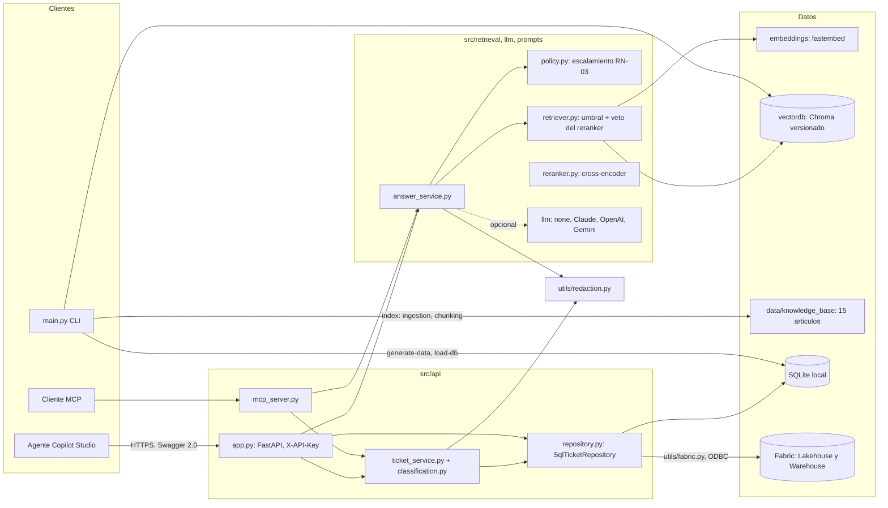
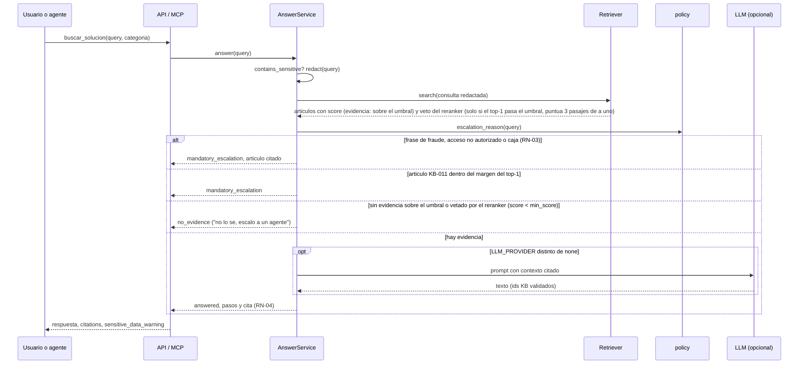
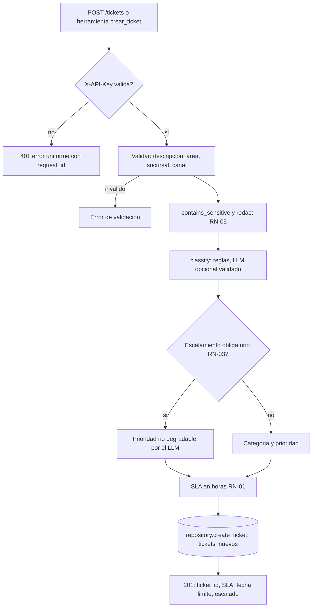
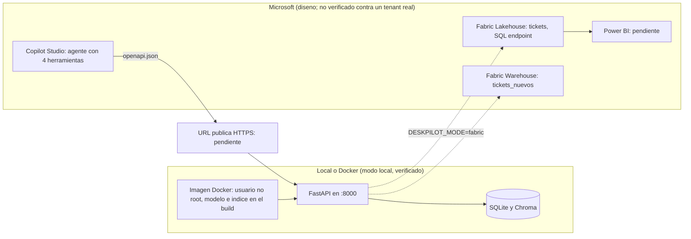

# Arquitectura

> Datos sintéticos generados para este proyecto; las cifras son ilustrativas. "Banco Altiplano" es ficticio.

DeskPilot AI tiene una capa de servicio única (RAG y tickets) expuesta por dos puertas: la API REST (FastAPI) y el servidor MCP. Las decisiones están en [`docs/adr/`](adr/README.md). Los nombres de módulos son los de `src/`.

## 1. Componentes

## 2. Flujo de una consulta RAG

El umbral (`retrieval.similarity_threshold`, 0.33), el veto del reranker cross-encoder (`retrieval.rerank.min_score`, 0.01; [ADR-0009](adr/0009-veto-con-reranker-cross-encoder.md)), el margen de escalamiento (`retrieval.escalation_margin`, 0.05; KB-011 se descarta solo si su score del reranker es < `min_score` x `mandatory_veto_factor` 0.1, ruido claro) y la redacción son los de `config.yaml` y `src/retrieval/answer_service.py`.

Si el LLM falla o devuelve citas no válidas, se usa la respuesta extractiva (ADR-0001). El veto del reranker no reordena ni sustituye artículos: solo convierte en `no_evidence` una respuesta cuyo mejor pasaje puntúa bajo `min_score`, y corre después de RN-03 para no callar nunca una escalación. EV-16 (fuera de dominio, coseno 0.525) fue el caso que lo motivó y hoy se rechaza; el límite honesto es HO-29 (ver README). El reranker se apaga con `retrieval.rerank.enabled: false`.

## 3. Flujo de `crear_ticket`

## 4. Despliegue

- **Verificado:** `docker build` y `docker run` en modo local, incluido `--network none` ([`docs/features/docker.md`](features/docker.md)).
- **No verificado:** modo `fabric` (la imagen Docker no incluye el driver ODBC 18), URL pública, agente en Copilot Studio y Power BI. Son tareas manuales (T28 a T34) en [`docs/roadmap.md`](roadmap.md).
