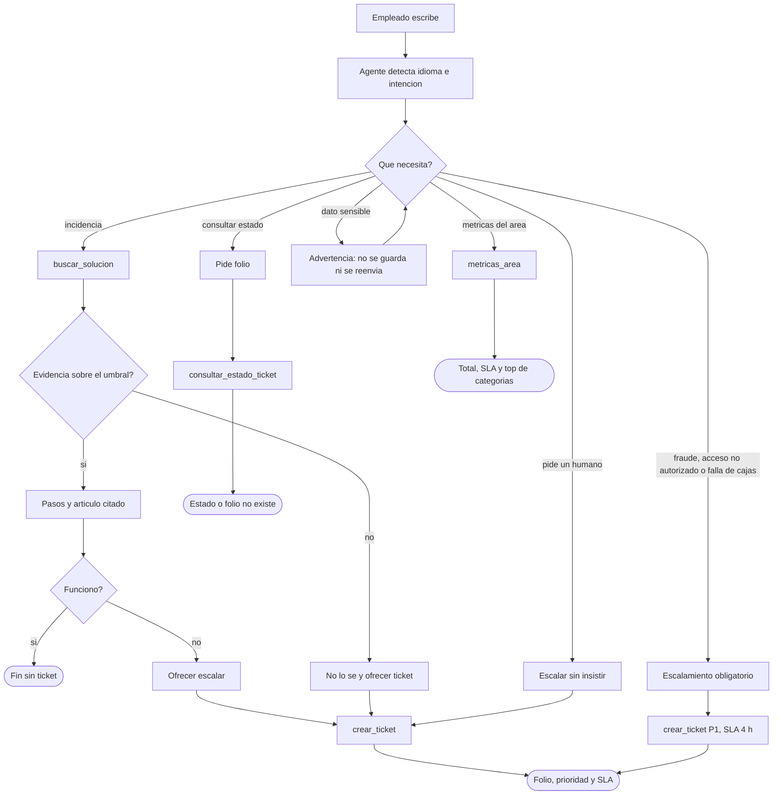
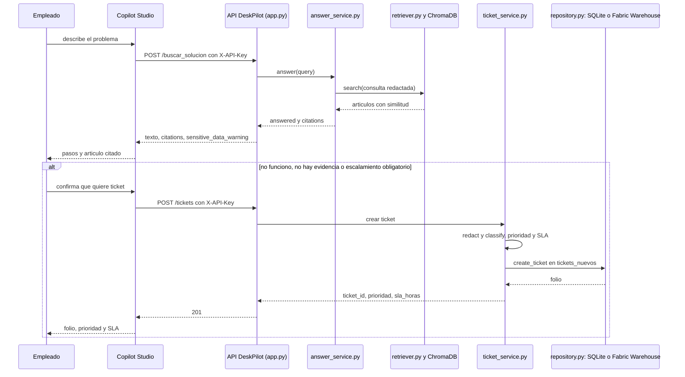

# Flujo del usuario

Datos sintéticos generados para este proyecto; las cifras son ilustrativas.

Este documento muestra qué pasa desde que un empleado de Banco Altiplano (ficticio) escribe al agente hasta que obtiene una respuesta citada o un ticket. Las reglas del agente están en [`integrations/copilot_studio/`](../integrations/copilot_studio/instructions.md); los componentes, en [`docs/architecture.md`](architecture.md). El agente en Copilot Studio está pendiente de validar en un tenant real (ver [`docs/roadmap.md`](roadmap.md)); las respuestas de los ejemplos vienen de la API local real.

## 1. Diagrama de decisión



Cómo leerlo:
- Cada mensaje pasa por el mismo punto de decisión; el agente responde en el idioma del usuario (RF-01).
- Una incidencia siempre empieza en `buscar_solucion`: solo se dan pasos si hay evidencia sobre el umbral de similitud; si no, el agente dice que no lo sabe y ofrece ticket.
- Los tres casos de escalamiento obligatorio (RN-03) saltan los pasos y van directo a un ticket P1, sin intentar resolver.
- Un dato sensible no abre una rama final: se advierte, no se guarda ni se reenvía a ninguna herramienta y la conversación continúa.
- Los óvalos son los finales visibles para el empleado.

| Paso del flujo | Herramienta | Requisito | Caso de evaluación |
| --- | --- | --- | --- |
| Detectar idioma e intención | (instrucciones del agente) | RF-01, RF-02 | EV-03, EV-05 |
| Buscar solución y citar el artículo | `buscar_solucion` | RF-03, RF-04, RF-12 | EV-01, EV-02 |
| Sin evidencia: "no lo sé" y ofrecer ticket | `buscar_solucion` | RF-05, RF-13 | EV-15, EV-17 |
| Preguntar si funcionó / ofrecer escalar | (instrucciones del agente) | RF-06 | EV-02 |
| Crear ticket con folio, prioridad y SLA | `crear_ticket` | RF-07, RF-16 | EV-23, EV-24, EV-25, EV-26 |
| Consultar estado por folio | `consultar_estado_ticket` | RF-08, RF-17 | sin caso en `cases.csv` (ver `integrations/copilot_studio/test-conversations.md`) |
| Pedir un humano | `crear_ticket` | RF-09 | sin caso en `cases.csv` (ver `test-conversations.md`) |
| Dato sensible: advertir, no guardar | `buscar_solucion` y `crear_ticket` (texto redactado) | RF-10 | EV-28, EV-29, EV-30 |
| Escalamiento obligatorio | `buscar_solucion` y `crear_ticket` (P1) | RF-05, RF-16 | EV-19, EV-20, EV-21 |
| Métricas del área | `metricas_area` | RF-19 | sin caso en `cases.csv` |

## 2. Diagrama de secuencia



Cómo leerlo:
- Copilot Studio nunca toca los datos: llama a la API REST con el encabezado `X-API-Key`, la misma capa de servicio que usa el servidor MCP.
- `answer_service.py` redacta los datos sensibles antes de buscar y consulta el índice vectorial (ChromaDB) con el umbral configurado.
- El bloque `alt` solo ocurre si hace falta escalar; el ticket se clasifica por reglas en `ticket_service.py`.
- En modo local el ticket se escribe en la tabla `tickets_nuevos` de SQLite; en modo `fabric` se escribe en `dbo.tickets_nuevos` del Warehouse (diseño, no verificado contra un tenant real).

| Paso del flujo | Herramienta | Requisito | Caso de evaluación |
| --- | --- | --- | --- |
| Recuperar con umbral y cita | `buscar_solucion` | RF-12, RF-13 | EV-01, EV-04 |
| Respuesta extractiva (sin LLM) | `buscar_solucion` | RF-14 | EV-06 |
| Escribir en `tickets_nuevos` | `crear_ticket` | RF-16, RF-18 | EV-23, EV-27 |
| Autenticación `X-API-Key` | (todas) | seguridad de la API | sin caso en `cases.csv` (pruebas de la API) |

## 3. Ejemplos reales

Corrida local el 2026-11-22: `python main.py serve --port 8765` con una `DESKPILOT_API_KEY` de prueba, índice y SQLite existentes, `LLM_PROVIDER=none`. Los JSON se enviaron con `curl --data-binary @archivo` para conservar UTF-8. El texto largo se recortó con `[...]`; la llave no se muestra. Los tickets de prueba se borraron de `tickets_nuevos` al terminar (0 filas).

### Español: incidencia con artículo citado (EV-02)

> Empleado: "Se bloqueó mi usuario de Windows después de varios intentos fallidos."

```bash
curl -s -X POST localhost:8765/buscar_solucion -H "X-API-Key: <clave>" \
  -H "Content-Type: application/json" --data-binary @a.json
```

```json
{"status":"answered","language":"es","text":"Sigue estos pasos del artículo KB-002 — Desbloquear un usuario de red bloqueado por intentos fallidos:\n1. Espera 15 minutos: el bloqueo [...] se libera de forma automática.\n[...]\n5. Si sigue bloqueada, usa la opción **Desbloquear mi cuenta** del Portal de Autoservicio [...]\n\nFuente: KB-002 — Desbloquear un usuario de red bloqueado por intentos fallidos","citations":[{"article_id":"KB-002","titulo":"Desbloquear un usuario de red bloqueado por intentos fallidos","seccion":"sintoma","similarity":0.7114}],"sensitive_data_warning":false,"mode":"extractive"}
```

Si no hay evidencia (EV-15, "robot de conciliación RPA"), la API no inventa pasos:

```json
{"status":"no_evidence","language":"es","text":"No lo sé, escalo a un agente humano. No encontré un artículo de la base de conocimiento con evidencia suficiente para tu caso. ¿Quieres que cree un ticket?","citations":[],"sensitive_data_warning":false,"mode":"policy"}
```

Tras confirmar, el agente llama a `POST /tickets` (con `descripcion`, `sucursal`, `area`, `canal`):

```json
{"ticket_id":"TCK-786312","estado":"abierto","categoria":"General","subcategoria":"Consulta general","prioridad":"P4","sla_horas":72,"fecha_apertura":"2026-11-22T16:04:59","fecha_limite_sla":"2026-11-25T16:04:59","escalado":false,"motivo_escalamiento":null,"sensitive_data_warning":false,"mode":"rules"}
```

Con una sospecha de fraude en la descripción, el ticket sale P1 y escalado:

```json
{"ticket_id":"TCK-287340","estado":"abierto","categoria":"General","subcategoria":"Sospecha de fraude","prioridad":"P1","sla_horas":4,"fecha_apertura":"2026-11-22T16:04:59","fecha_limite_sla":"2026-11-22T20:04:59","escalado":true,"motivo_escalamiento":"fraud","sensitive_data_warning":false,"mode":"rules"}
```

### English: same flow, answer in English (EV-03)

> Employee: "My bank token shows Invalid key and the codes are rejected."

```json
{"status":"answered","language":"en","text":"Follow these steps from article KB-003 — El token bancario no genera claves válidas (the knowledge base is in Spanish, so the steps are quoted as written):\n1. Revisa que la pantalla del token encienda [...]\n[...]\n6. Solicita a la mesa de servicio la resincronización. [...]\n\nSource: KB-003 — El token bancario no genera claves válidas","citations":[{"article_id":"KB-003","titulo":"El token bancario no genera claves válidas","seccion":"sintoma","similarity":0.6993}],"sensitive_data_warning":false,"mode":"extractive"}
```

Límite real: con `LLM_PROVIDER=none` el encabezado y la fuente salen en inglés, pero los pasos se citan tal como están en la base de conocimiento (en español).

Consulta de un folio inexistente (HU-03):

```json
{"code":"ticket_not_found","message":"Ticket not found.","request_id":"2fba8e65ec174470826594fe01659900","details":null}
```
